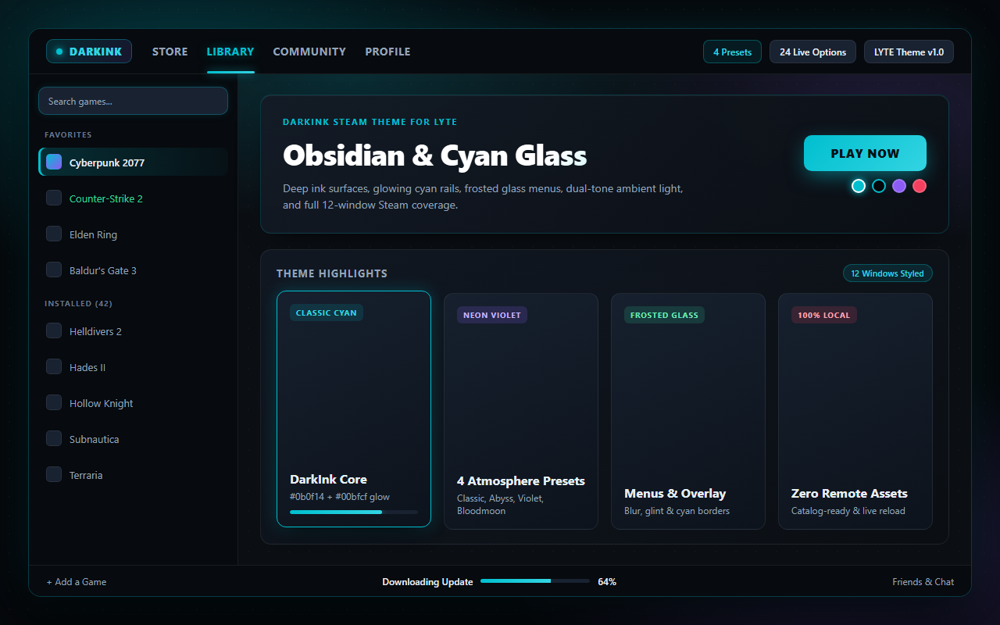

# DarkInk — Steam Theme for LYTE

An obsidian-dark Steam client theme crafted in the **DarkInk** visual identity: deep ink surfaces (`#0b0f14`), signature cyan accents (`#00bfcf`), subtle dual-tone cyan/violet ambient lighting, frosted obsidian glass menus, and full coverage across all 12 LYTE window targets.

## Features

- **Full 12-Window Coverage:** Styles `main` (Library, TopBar, Sidebar, Downloads), `settings` (including LYTE Settings panels), `friends` (Friends list, Chat, Mini-Profiles), `menus`, `notifications`, `overlay`, `dialogs`, `store`, `community`, and `web`.
- **4 Built-In Color Presets:**
  - **DarkInk Classic** — Obsidian `#0b0f14` with DarkInk Cyan (`#00bfcf`) & Violet ambient glow
  - **DarkInk Abyss (OLED)** — Pure deep black (`#05070a`) with Cyan accents
  - **DarkInk Neon Violet** — Midnight indigo (`#0e0b17`) with Violet (`#8b5cf6`) & Cyan glow
  - **DarkInk Bloodmoon** — Dark crimson (`#11090c`) with Rose-Red (`#f43f5e`) highlights
- **24 Live Customization Options:** Adjust accent colors, surfaces, corner radius, cover radius, sidebar width, navigation density, framed vs. clean shelves, frosted glass strength, cover hover lift, ambient glow, DarkInk background motif, scrollbar style, and hide the What's New shelf — all live without restarting Steam.
- **100% Self-Contained:** Zero external `@import` rules and zero remote assets. All styles and textures are bundled locally.

## Installation

### From LYTE Catalog
1. Open the **DarkInk** card on the LYTE Themes catalog and click **Install** (or copy its 32-character catalog ID into **Steam Settings → LYTE → Themes**).
2. Toggle **DarkInk** on.
3. Open **Options** on the theme card to pick a preset or customize colors, glass, and layout live.

### Local Folder (Development / Manual)
1. Clone or download this repository.
2. Open **Steam Settings → LYTE → Themes** and click **Import folder**.
3. Select the repository root folder (containing `lyte.catalog.json` and `lyte.theme.json`).
4. Toggle **DarkInk** on.

## License

MIT — see [LICENSE](LICENSE).
